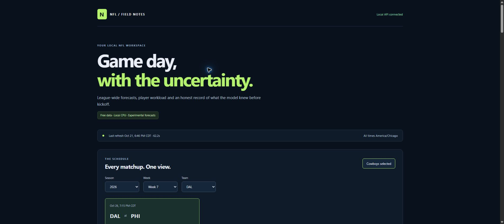
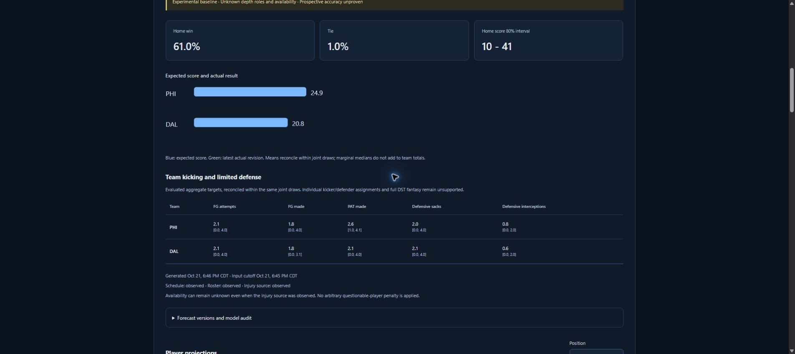
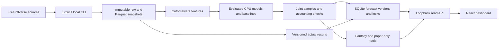

# NFL Prediction App

A local Python/FastAPI + React/TypeScript research app for the full NFL league,
with Cowboys filters, offensive player baselines, coherent game simulations,
versioned pregame forecasts, fantasy lineup comparisons and a paper-only ledger.
Implementation prompts 01-15 are completed locally. Models remain experimental;
unknown depth roles, availability and incomplete participation coverage are visible.

No paid feeds, GPU, Docker, cloud deployment, real-money wagering or league logins
are required. Nothing has been pushed or published, and no scheduled task is installed.



The screenshot uses real downloaded schedules and explicitly experimental local
forecasts. It is not synthetic prediction history or evidence of future accuracy.

## Supported scope

| Area | Implemented | Limits |
|---|---|---|
| Games | Regular/postseason schedule, expected scores, win/tie samples and intervals | Approximate box-score simulation, not full play-by-play |
| QB/RB/WR/TE | Passing/rushing/receiving counts, yards and TDs; interceptions; participation scenarios | Unresolved depth roles; empirical participation is not an injury-health probability |
| Team additions | FG/PAT attempts/makes, defensive sacks/interceptions | Team aggregates; no individual kicker/defender assignments or complete DST fantasy |
| History | Immutable versions, pregame locks, missing-forecast records and corrected actuals | Existing past games never get invented pregame forecasts |
| Fantasy | Manual weekly rosters, standard/half-PPR/PPR offensive subtotals, exact slot/FLEX assignment, risk preferences | Individual fumbles/two-point bonuses/kicking/defense excluded and labeled |
| Paper | Manual lines, virtual credits, probabilities/EV, integer ledger and correction audit | No real funds, automatic wagers or live odds feed |
| Coverage | Completed 2020-2025 sources and partial 2026 snapshots, full league | No evaluated preseason, individual defenders/returners or complete on-field roles |



## Setup and run

Requirements: Windows PowerShell, Python 3.13, Node.js 24, Git and uv 0.13.1.
The machine verified on October 21 used Python 3.13.2, Node 24.14.1 and npm 11.11.0.
Exact Python and frontend packages are locked in uv.lock and frontend/package-lock.json.
Run commands from this repository root:

```powershell
py -3.13 -m pip install uv==0.13.1
py -3.13 -m uv sync --locked
npm.cmd --prefix frontend ci
```

.env is optional. If needed, copy .env.example only when .env does not already
exist. Keep credentials, datasets and models out of Git. Do not change loopback
binding to a public address.

In separate terminals:

```powershell
.\.venv\Scripts\nfl.exe serve
npm.cmd --prefix frontend run dev
```

Open **http://127.0.0.1:5173**. The read API/OpenAPI is at
http://127.0.0.1:8000/docs. A clean install initially shows honest empty states;
real datasets/models are not bundled. After CLI refreshes, reload the browser to
read newly saved versions. Stop servers with Ctrl+C in their terminals.

HTTP writes require loopback Host/client, a trusted local origin, an explicit
X-NFL-Local header and bounded JSON. There is no remote authentication or CORS grant.
The API does not train models or download data during requests.

## Reproduce data and models

Use emitted directories/IDs below; IDs change with source, features or code.
Commands are intentionally separate so training never runs as a page-load side effect.

```powershell
.\.venv\Scripts\nfl.exe audit-sources --current-season 2026
.\.venv\Scripts\nfl.exe ingest --current-season 2026
.\.venv\Scripts\nfl.exe capture-pregame --season 2026
.\.venv\Scripts\nfl.exe build-features --output artifacts/features
.\.venv\Scripts\nfl.exe check-backtest artifacts/features/FEATURE_ID
.\.venv\Scripts\nfl.exe models train-games artifacts/features/FEATURE_ID
.\.venv\Scripts\nfl.exe models evaluate-games artifacts/models/GAME_MODEL_ID
.\.venv\Scripts\nfl.exe models promote-games artifacts/models/GAME_MODEL_ID
.\.venv\Scripts\nfl.exe audit-participation
.\.venv\Scripts\nfl.exe models select-offense artifacts/features/FEATURE_ID data/participation/PARTICIPATION_ID
.\.venv\Scripts\nfl.exe models extended-baselines artifacts/features/FEATURE_ID
```

Source audit may exit 1 for documented injury timestamp/schema limitations; do not
convert that into a successful coverage claim. Free public downloads require network
access. Approximate historical box scores lack original pregame publication histories;
prospective local observations are not backdated to old game weeks.

The final test is recorded once per fixed model. Do not repeatedly tune against the
already observed 2025 results. The original offensive experiment remains frozen;
new player defaults are selected on earlier folds and await prospective evaluation.
For new additional team targets, the first fixed 2025 test is separately documented.

Copy config/refresh.example.json to ignored config/refresh.local.json once and replace
its model/participation IDs with your emitted paths. The example contains this
machine's verified checkpoints, including the optional team component model.

```powershell
.\.venv\Scripts\nfl.exe refresh
.\.venv\Scripts\nfl.exe refresh --cached-sources
.\.venv\Scripts\nfl.exe refresh --scheduled
```

Refresh reuses frozen models, validates schemas/freshness, predicts only upcoming
games, publishes each eligible game atomically, locks due games and reconciles
actual/paper revisions. --cached-sources still checks freshness. Daily/pregame
schedule gating, retries, OS locks, failure logs, offline catch-up and **manual**
Task Scheduler setup are in [local_refresh.md](docs/local_refresh.md). No command
installs a task. Sleeping/offline computers miss updates; waking late cannot invent
a pregame forecast. Conservative reschedule rules preserve history and may leave a
game without a usable official comparison.

## Verification and CI

```powershell
.\scripts\check.ps1
# Or run the same checks directly if local script policy blocks helpers:
.\.venv\Scripts\ruff.exe check .
.\.venv\Scripts\ruff.exe format --check .
.\.venv\Scripts\python.exe -m pytest -q
npm.cmd --prefix frontend run format:check
npm.cmd --prefix frontend run build
# Explicit generated-fixture end-to-end flow:
.\.venv\Scripts\python.exe -m pytest tests/test_end_to_end.py -q
```

Tests generate tiny labeled fixtures; they do not download full datasets or require
paid credentials. The end-to-end smoke covers ingestion, causal features/baselines,
joint simulation, pregame publication/locking, roster comparison, virtual staking,
settlement, corrected actuals and read API identity. Checks include leakage,
missing-vs-zero semantics, football accounting, reschedules, kickoff locks, host/
origin protection, duplicate settlement and integer credit conservation.

.github/workflows/checks.yml defines Windows/Linux checks using verified pinned
official action commits, locked installs, tests, formatting and frontend build.
It has read-only repository permissions and no deployment/publication steps. The
new workflow has not run remotely because it was not pushed. Existing origin
configuration was preserved; no remote was created or changed. Its commands
were verified locally, including a new clean Python environment and clean frontend.

## Measured results and limitations

Historical results are approximate corrected-source backtests, separate from
published pregame performance. There are no completed scored official pregame games
yet in this newly created local history. The explicitly labeled verification roster
and virtual account are test artifacts, not the user's actual league or real bets.

| Evaluation | Measured result | Interpretation |
|---|---|---|
| Game-model 2025 holdout | 285 games; 61.4% three-way accuracy; 0.663 log loss; 10.17-point margin MAE | Selected regularized model; not prospective production accuracy |
| Earlier game validation log loss | League 0.705; rolling 0.673; linear 0.665; tree 0.673 | Simpler regularized model retained; tree did not help |
| Player 2021-2024 nested validation | QB pass-yard MAE 70.553 (2,625); RB rush 20.669 (6,390); WR receive 23.251 (9,522); TE receive 16.599 (4,572) | Lag reference retained because alternatives were worse; selected participation coverage |
| Additional team 2025 targets | FG-made MAE 1.005 (570); defensive sack MAE 1.372 (561); interception MAE 0.690 (570) | Aggregate targets only; excluded sack-credit disagreements and imperfect interval coverage |
| Expanded joint 2024 week-1 check | 16 games/100 draws; Brier 0.470; nominal 80% score coverage 90.6% | Small diagnostic; win calibration did not improve over the earlier version |

Learned game-model parameters are fitted regression/classification weights and
training-derived preprocessing. Hyperparameters (regularization, history windows,
shrinkage, simulation count/dispersion assumptions) control training/inference and
are fixed or selected using earlier validation. Player/team additions retain evaluated lag/rate
baselines rather than inventing learned injury or depth-chart effects.

Unverified competing roles can inflate player/team volume; other-player buckets
and this reconciliation remain explicit. Injury probability and individual playing
time are not solved. Marginal medians do not sum to team medians. Wide intervals
and small validation samples must not be presented as calibrated betting edges.
Full kicking/DST fantasy, individual defenders/returners, pretrained text models,
cloud hosting and preseason models remain outside supported outputs.

## Measured local operations

October 21 Windows 11 measurements, with installed Python/Node runtimes:

| Operation | Measurement |
|---|---:|
| Clean Python dependency environment + empty download cache | 11.28 seconds, 49 packages |
| Clean frontend dependency environment + empty download cache | 3.17 seconds, 27 packages |
| Game training/selection, excluding interpreter imports | 0.835 seconds wall; 0.807 internal; held-out test not rescored |
| Current cached-source 14-game refresh, 100 draws/game | 42.51-62.22 seconds across recorded runs |
| Benchmark process peak working set | 212.4 MiB at game training; 808.4 MiB after full refresh |
| Data file bytes after review | 208,735,356 bytes (about 199 MiB) |
| Artifact file bytes after scratch cleanup | 240,078,131 bytes (about 229 MiB) |
| Current-season free ingestion | 3.775 seconds; 11,039,249 downloaded bytes; 93 completed 2026 games |
| Earlier full 2020-2026 ingestion checkpoint | 26.829 seconds; 120,607,965 newly downloaded bytes, with some prior cache |

These are measured runs, not performance guarantees or cold OS/runtime installation
times. Peak memory includes the entire process, not just incremental model arrays.
Data/model artifacts remain ignored. Defaults use 100 draws; 500 was measured, while
the configured upper bound is not a memory/performance guarantee. Storage totals,
commands, hashes and detailed timings are in
[release_measurements_2026-10-21.json](docs/release_measurements_2026-10-21.json).
An explicit repeat benchmark is `python scripts/measure.py --features FEATURE_PATH`;
it uses cached sources and trains a separate candidate without rescoring the test.

## Architecture and operations



[Architecture](docs/architecture.md), [decisions](docs/decisions.md),
[forecast history](docs/forecast_history.md), [player policies](docs/participation_and_offense.md),
[simulation contract](docs/simulation_contract.md), [expanded coverage](docs/expanded_coverage.md),
[fantasy](docs/fantasy.md), [paper ledger](docs/paper_ledger.md),
[source attribution/rights](docs/data_sources.md), [recovery](docs/operations.md),
[resume evidence](docs/resume.md) and [stage-by-stage progress](docs/progress.md).

Before any future hosting/public release: authentication/access control, HTTPS,
consistent backups, a durable single-writer job service, concurrency/load review,
secret management, monitoring, retention and source redistribution/licensing review
must be addressed. This local checkpoint does not deploy, create a remote, push,
publish, install a scheduled task or authorize real-money transactions.
